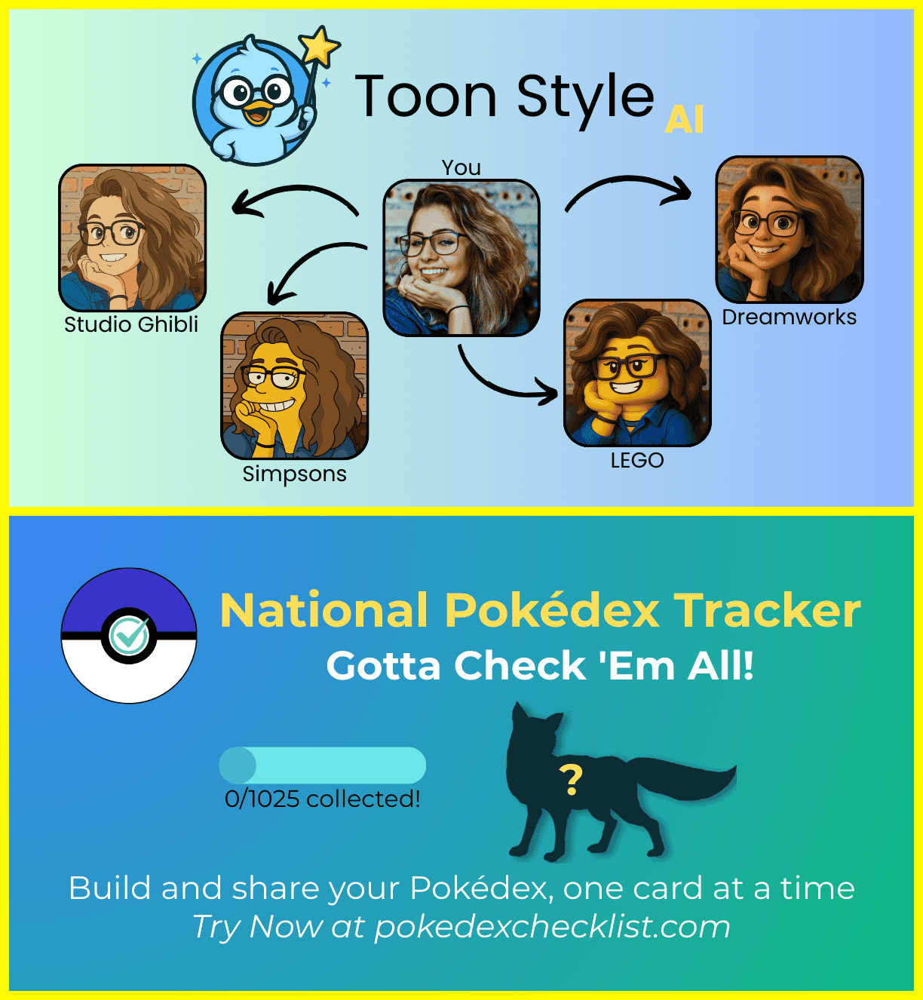
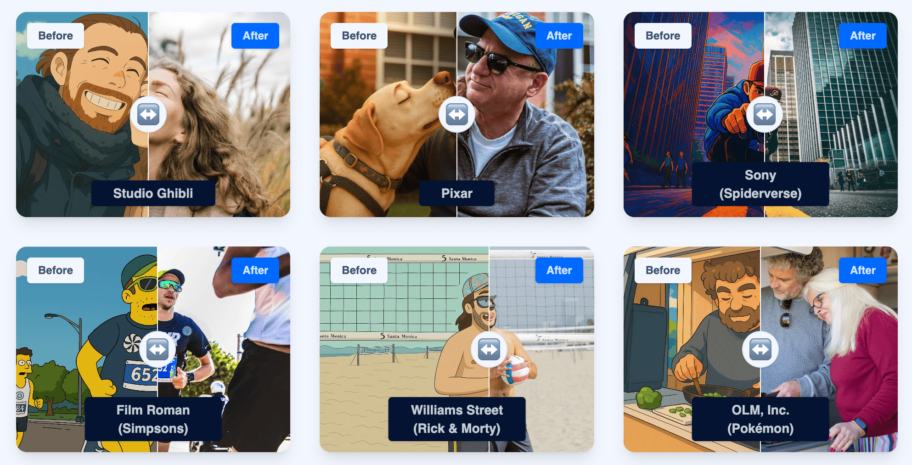
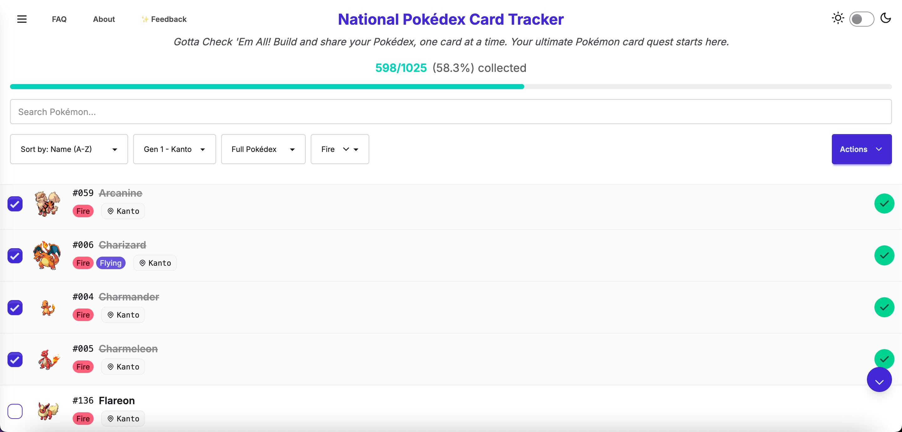
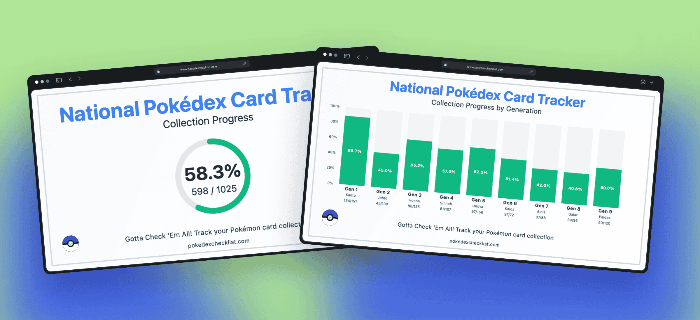

After releasing GlobeFlix in 2024, I worked on two new projects in 2025: [ToonStyle AI](https://www.toonstyleai.app/) in the first half of 2025, and [Pokédex Checklist](https://www.pokedexchecklist.com/) in the second half of 2025.

<!--more-->

# Moving from Globeflix to ToonStyle AI

After launching [GlobeFlix](https://www.globeflix.app/) on [ProductHunt](https://www.producthunt.com/products/globeflix?embed=true&utm_souce=badge-globeflix&launch=globeflix) and [TinyLaunch](https://www.tinylaunch.com/launch/1056) (where it won #1 product of week), I switched to another idea. With the hype of AI-generated “Ghibli” images, I decided to create yet another AI image generator but with a twist. To combine my passion for movies, I wanted to create a web app that could transform your images into the styles of the famous animation studios (think Pixar, Dreamworks, Disney, etc.).

# Lessons from ToonStyle AI

I built the website with Cursor AI for the first time, and completed it quite quickly. However the downside is that I barely touched the code and fully vibe-coded it, but LLMs weren’t that good yet. When I ran into a large issue on the production version of the website (not the one I develop on, but the public one that internet users can visit), both me and Cursor were unable to fix the issue quickly as it essentially required an entire re-work of the website logic. So I gave up working on this project and left in Waitlist mode.

So my lesson for this project is that it’s ok to vibe-code to accelerate, but I should still be aware of the code that is being produced so that I can edit it myself. (2026 edit: this is no longer the case, LLMs in JJune 2026 could easily fix this).

# Next Idea: Pokédex Checklist

After ToonStyle AI, I switched to a passion project. After getting back into Pokémon collecting, I decided to start a challenge: completing the national Pokédex (1 of each of the 1025 Pokémon species, regardless of set, language, rarity). 

So I built myself a tool to do so and made the MVP free to use for all with some cool features such as:

- simple checklist with no login
- local saving for offline
- powerful search/filtering/sorting tools
- export/import to/from CSV
- light/dark modes
- Export graphics to share progress with friends or on social media

I posted progress on [X](https://x.com/Adamouization), did a small launch on [ProductHunt](https://www.producthunt.com/products/pokedex-checklist?embed=true) and [TinyLunch](https://www.tinylaunch.com/launch/6690) (which earned #2 product of the week), and it quickly grew to 4300+ monthly users.

But I had no real way to track/understand what they were doing, so I need to change something for 2026.

My plan for 2026 is to add some premium features, understand my users and monetise Pokédex Checklist. I will document this in a future blog post.

## June 2026 update

PokédexChecklist has generated [$588 in revenue](https://trustmrr.com/startup/pok-dex-checklist) with over 24k+ monthly users and 40 premium users.

