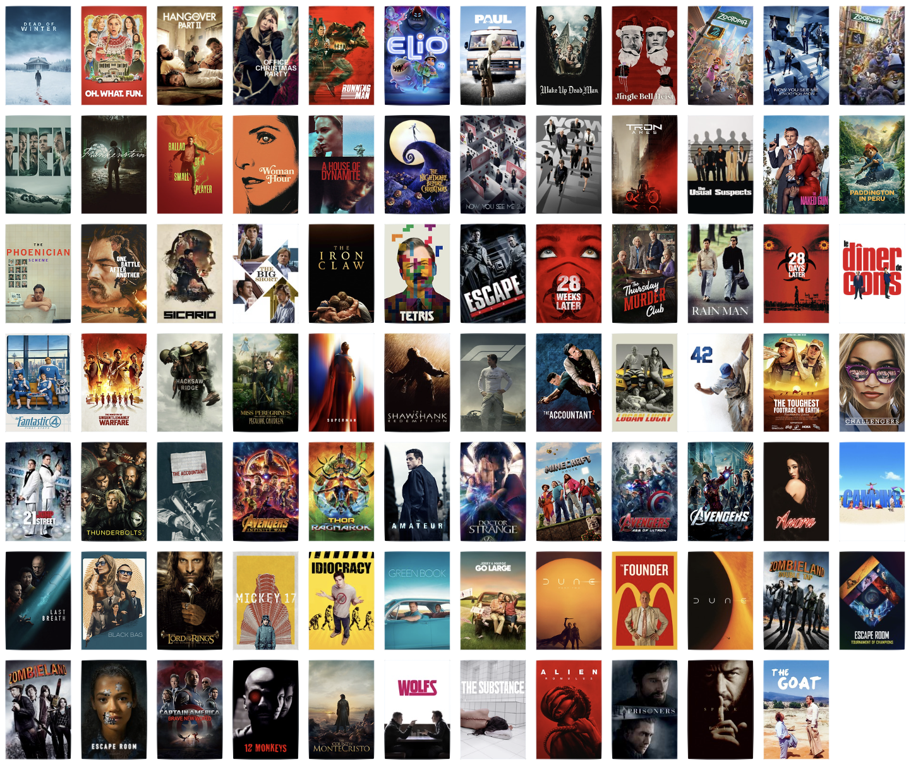
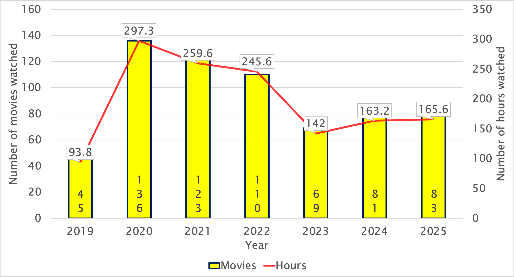
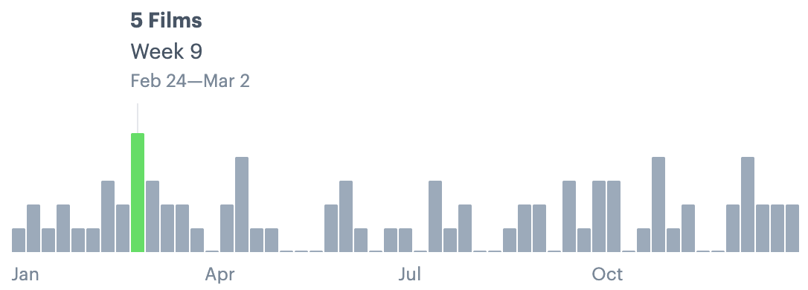
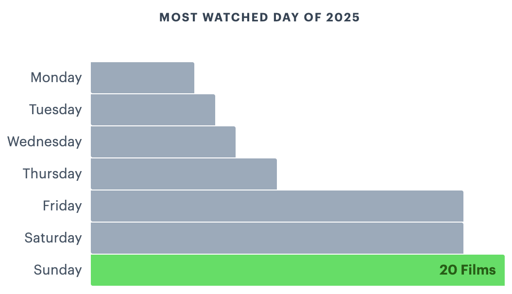

Like every year, I enjoy compiling a summary of movies I watched throughout the year, as I find that some years are defined by the quality of the movies we watch, or committing to a series of movies like “watching all Star Wars” movies. So these short posts act as time capsules for me whenever I revisit them.

<!--more-->

In 2025, I watched 83 movies, which was two more than in 2024. But I thought I’d summarise how many movies I’ve watched per year since I started tracking this data in 2019. And (not surprisingly), 2025 is the 4/7th year with most movies watched (top years being the infamous covid years).

This table summarises my top-rated movies since 2019, released in the same year that I watched them:

| Year | Hours | Entries | Top Movie from that year |
| --- | --- | --- | --- |
| 2019 | **93.8** | 45 |  Toy Story 4; Alita: Battle Angel |
| 2020 | **297.3** | 136 |  Tenet; The Trial of the Chicago 7 |
| 2021 | **259.6** | 123 |  Don’t Look Up; Spider-Man: No Way Home; Dune; Schumacher; Beckett |
| 2022 | **245.6** | 110 |  The Banshees of Inishering |
| 2023 | **142** | 69 |  Spider-man Across the Spider-verse |
| 2024 | **163.2** | 81 |  Dune Part 2; The Wild Robot |
| 2025 | **165.6** | 83 | One Battle After Another; Wake Up Dead Man; F1; The Phoenician Scheme |

In 2025, I also watched some random assortment of movies that ended up having the same actors/directories, and ended up watching 8 movies with the actor Mark Ruffalo and 4 movies directed by Denis Villeneuve!

The week I watched the most movies was the week February 24th → March 2nd, which was a week where I was on sick leave from work.

And unsurprisingly, the weekday I watched the most movies remains Sundays, and it’s exactly the same number as in 2024 (20 movies).

Since 2019, I have been tracking every movie I watched via Letterboxd, 
an online social cataloguing service. You can add me here: [https://letterboxd.com/adamouization/](https://letterboxd.com/adamouization/). And you can also see the full year in movie here: [https://letterboxd.com/adamouization/year/2025/](https://letterboxd.com/adamouization/year/2025/).