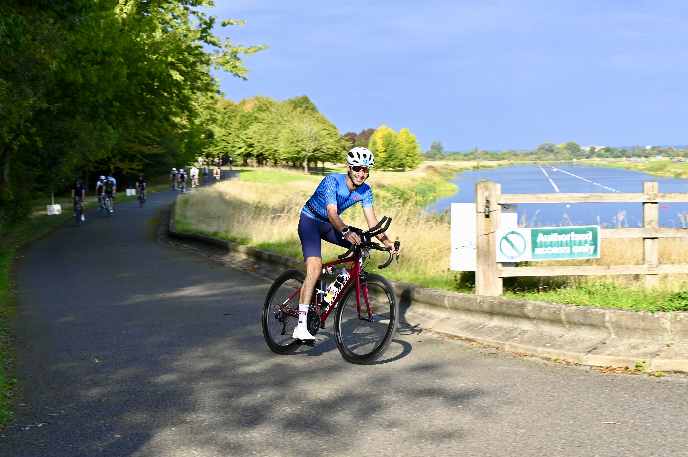
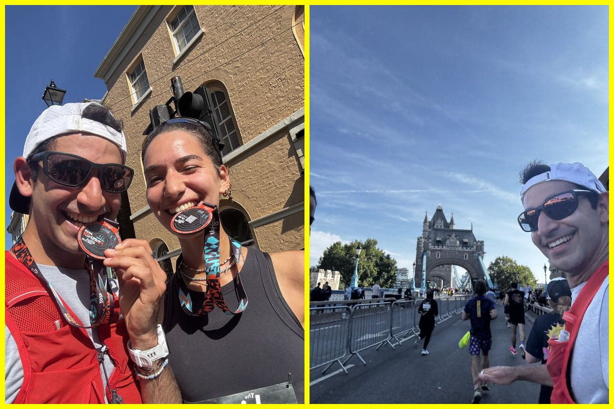
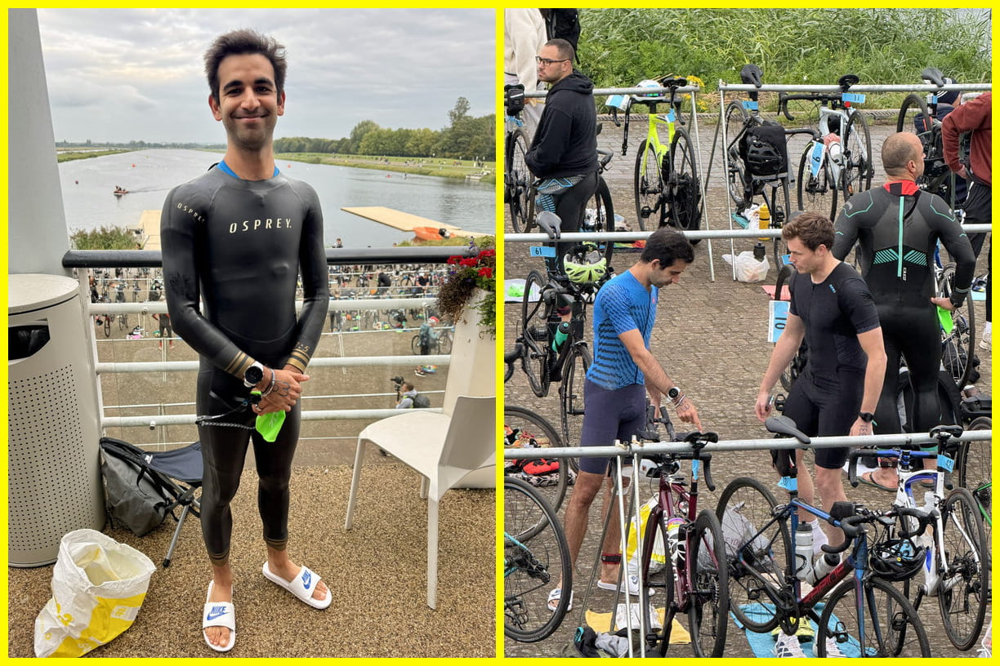
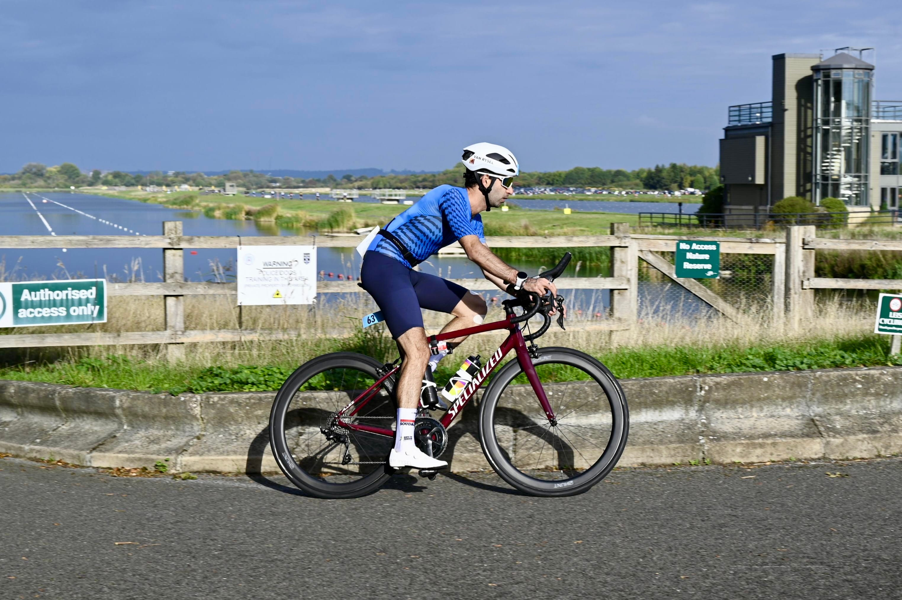
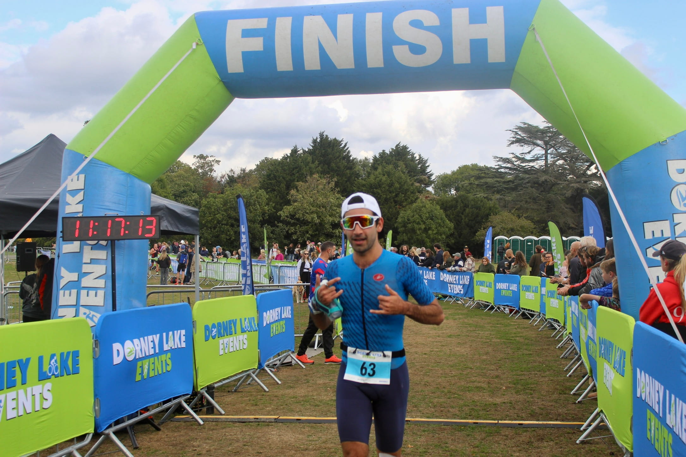
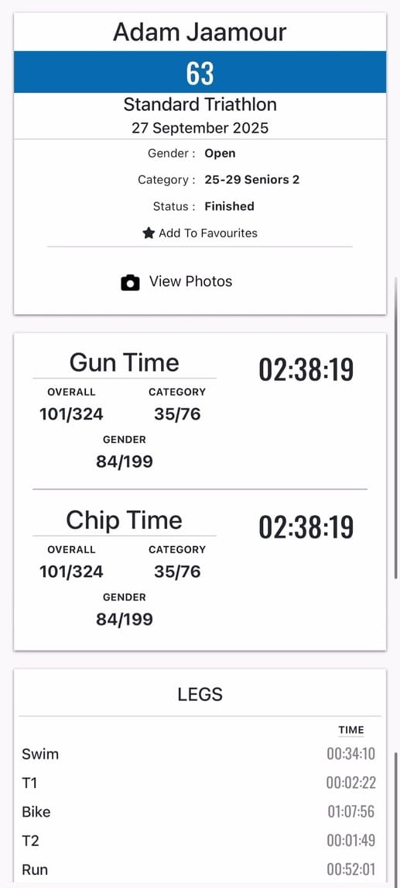

Following my [IronMan 70.3 in Swansea](https://adamouization.github.io/2025/07/13/first-ironman-70-3/) in July 2025 and not achieving my sub-6h goal, I decided to achieve a secondary goal that I set for 2025, which was setting a PB over the olympic distance (which was my first tri). So I signed up for the Dorney Olympic triathlon in September 2025 with one goal: beat my [2h57 time from my first triathlon in 2024](https://adamouization.github.io/2024/07/28/first-triathlon/).

<!--more-->

# Post-IM 70.3

In the weeks following the Swansea Ironman 70.3, I slowed down training throughout July, with a smaller running volume to let my left knee rest, a focus on cross-training (in the form of racket sports and reformer pilates) and more social rides with friends (including my longest ride - 130km).

Unfortunately, I also had my first big bike crash while on vacation in August in the Dolomites (Italy). While descending on a gravel bike on a steep downhill on paved road, I was going too fast to avoid a patch of small rocks in a sharp turn and fell hard on my face. This put me out of any triathlon training for a solid 2 weeks. I therefore had 1 month to carry over my middle-distance triathlon shape for the Olympic triathlon in Dorney. Additionally, this massively lowered my confidence riding downhill (which is probably for the better now that I look back!)

# Post-accident training

In the weeks leading up to the race, I returned to structured training for the month of September, aiming for 2 swims, 2 rides and 2 runs per week. The goal was to increase confidence on the bike and in myself.

I slowly got a bit more confidence back on the bike at high speeds, but still struggled on descends and sharp turns. A big boost in confidence was running the London Big Half Marathon race spontaneously with my sister to cover a bib that was going to go to waste otherwise, and running mainly in Z2-Z3 to finish in 2h02.

# Race

### Swim

Come race day, the swim was truly freezing from my perspective, with the water at chilling 12 degrees Celsius! It was my coldest swim ever and it gave me a serious headache (I come from a warmer country, I don't deal with cold water very well...) It took me 34 minutes to complete with an average pace of 2:13/100m, a forgetable performance, but at least I finished!

Strava: [https://www.strava.com/activities/15951039968](https://www.strava.com/activities/15951039968)

### Bike

Following a very quick transition of 2m22s, I started biking the eight 5k laps on the west side of Dorney Lake. I only got into a good rhythm on the 3rd lap as I was shaking from the cold for the first 2 laps. After warming up, I managed to hold a constant 33 kph over this flat course to finish in 1h08m.

[https://www.strava.com/activities/15952023673](https://www.strava.com/activities/15952023673)

### Run

The run was uneventful (which is a good thing as it went to plan), holding a very constant pace of 5:14/km across the 2 laps on the east side of Dorney Lake. Everything was on point here, and the only thing I regret is not pushing more as I was at an average heart rate of 163 bpm, and could have pushed harder on the second lap.

Overall, I finished in 2 hours and 38 minutes, beating my original [Olympic triathlon time at the 2024 London T100](https://adamouization.github.io/2024/07/28/first-triathlon/) by 19 minutes, which was the goal. 

Strava:  [https://www.strava.com/activities/15951040032](https://www.strava.com/activities/15951040032)

# What’s Next

I’ve got big plans for 2026, as I’m getting a new TT bike, aiming to improve my swim and aiming to run HM distances faster. I’ve signed up for the following races to test myself next year:

- Tour of the Peaks (190k bike race with 3900m elevation gain) in May 2026
- London T100 in July 2026
- Ironman 70.3 Weymouth in September 2026